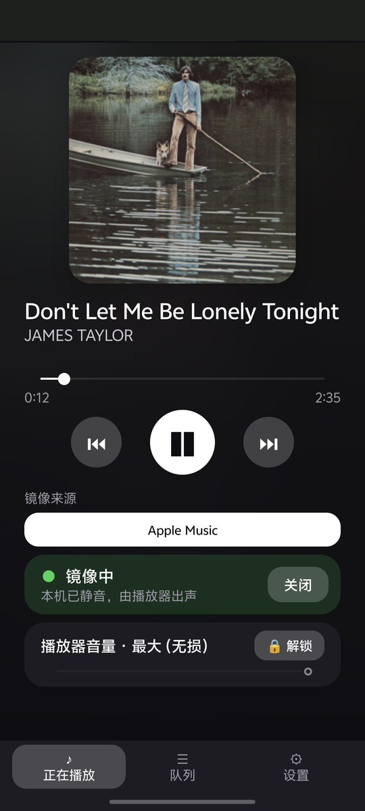
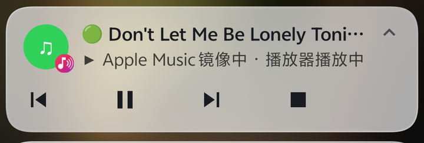
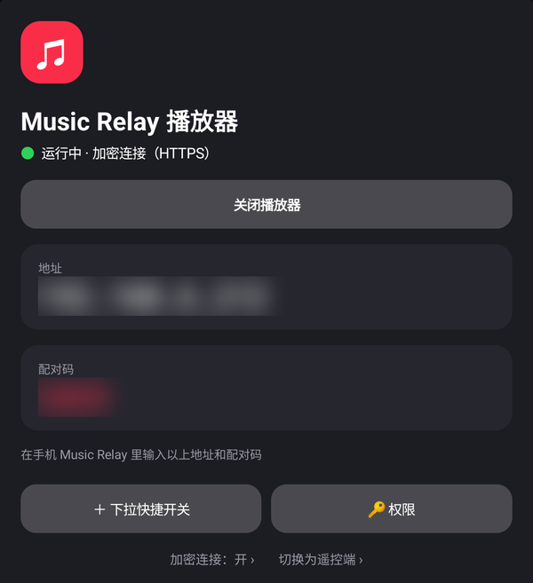
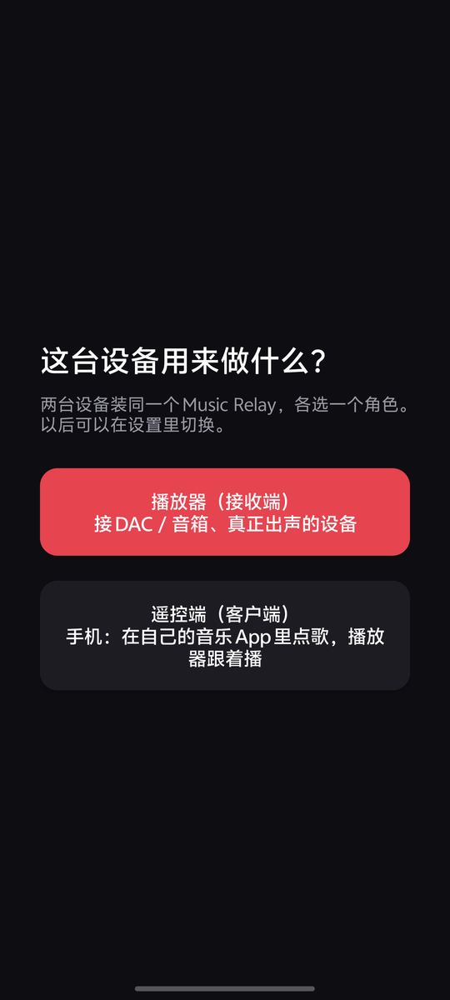
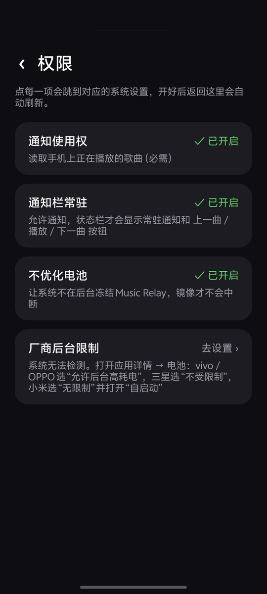
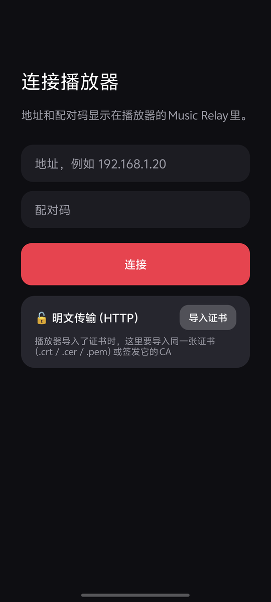
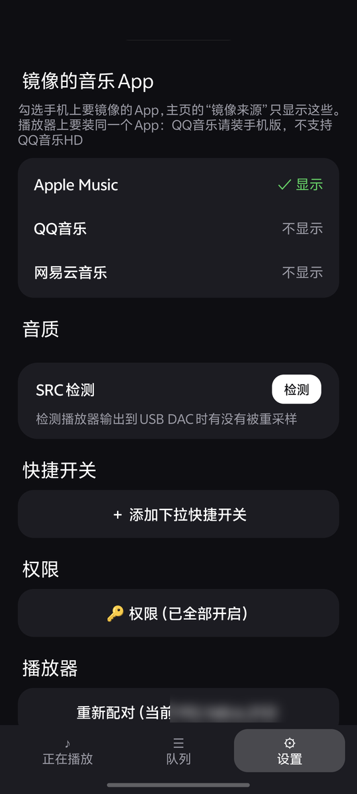
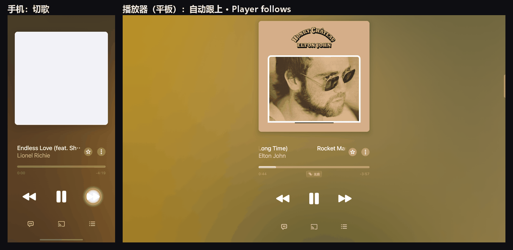

<h1 align="center">Music Relay</h1>

<p align="center">
  Pick songs in your phone's own music app and have another Android device — a tablet or TV box wired to a DAC or speakers — play them.
</p>

<p align="center">
  <b>English</b> · <a href="README.zh-CN.md">简体中文</a>
</p>

<p align="center">
  
  
  
</p>

> The app's interface is in Chinese. This README walks through every screen.

## Why

Apple Music, QQ Music and NetEase Cloud Music on Android have no "pick on the phone, play on another device" feature like AirPlay or Spotify Connect.
Music Relay keeps it simple: **both devices run the official music app, signed in to the same account; Music Relay only keeps them in step — which song, where in it, playing or paused.**

```
Phone (remote)                                         Player (receiver)
official app ── reads the playing song's ID ──► Music Relay ── LAN ──► Music Relay ──► official app ──► DAC / speakers
(muted)                                                                 (plays the same song by ID)
```

- No audio is streamed and no DRM is touched or bypassed; the sound is whatever the official app produces on the player.
- Only public Android APIs: MediaSession (via notification access) and the apps' own song links.

## Features

- **Mirror mode** — skip, pause or seek in the phone's music app and the player follows within a second; the phone mutes itself.
- **Supported apps** — Apple Music, QQ Music, NetEase Cloud Music. Choose which ones appear, or let "Auto" follow whichever is playing.
- **Notification controls** — the ongoing notification has ⏮ ⏯ ⏭ buttons on both devices; the phone's also has "Stop mirroring".
- **Quick Settings tile** — switch mirroring (phone) or the player (receiver) on and off like a VPN toggle.
- **Play queue** and **player volume** (locked at max by default to avoid digital attenuation).
- **SRC check** — shows whether the player's output to a USB DAC is resampled, and why.
- **One app, two roles** — the same APK; choose "Player" or "Remote" on first launch, switch later in settings.
- **Permissions page** — lists every permission with its status; tap to jump to the matching system screen.
- **Optional encryption** — one switch on the player; the phone detects it when pairing, no setup.

## Requirements

| | |
|---|---|
| Android | 11 or newer on both devices, on the same LAN |
| Music app | the **same** music app on both devices, signed in with a subscription |
| QQ Music | the player needs the **phone edition of QQ Music** (`com.tencent.qqmusic`). **QQ Music HD is not supported**: its song IDs are local numbers and it cannot play a song by ID. Install the regular "QQ音乐" from the app store, also on tablets. |

## Install

Download `music-relay-<version>.apk` from [Releases](../../releases) and install it on both devices.

## Getting started

### 1. Player: choose the role

On the device wired to the DAC or speakers, open Music Relay and choose **播放器（接收端）** (Player).



### 2. Player: grant permissions

Tap **🔑 权限** (Permissions) and fix every item marked 未开启 (off). Each item opens the right system screen; the list refreshes when you come back.



| Permission | Why |
|---|---|
| Notification access | read and control the local music app (required) |
| Notifications | show the ongoing notification with playback buttons |
| Battery optimization off | keep the system from freezing Music Relay in the background |
| Vendor background limits | vivo: App info → 电量 → 后台耗电管理 → **允许后台耗电**; Samsung: Battery → Unrestricted; Xiaomi: Battery saver → No restrictions + Autostart |
| Display over other apps | QQ Music and NetEase song links are opened from the background |
| Usage access | check whether a music app is in front, so switching songs never covers what you are using |
| SRC check (optional) | one-time `adb shell pm grant app.musicrelay android.permission.DUMP` from a computer |

### 3. Player: note the address and pairing code


### 4. Phone: choose Remote and pair

Open Music Relay on the phone, choose **遥控端（客户端）** (Remote) and enter the player's address and pairing code. Then grant permissions under **设置 → 🔑 权限** (Settings → Permissions).



### 5. Phone: choose which apps to mirror

**设置 → 镜像的音乐 App** (Settings → Apps to mirror): tick the apps you use. Only these show up as mirror sources on the main page.



### 6. Turn mirroring on and play in the phone's music app

Tap **开启** (On) on the main page, or the **Relay 镜像** tile. The phone mutes; from then on play, pause, skip and seek in the phone's Apple Music / QQ Music / NetEase, and the player does the same.



Skip from the notification:


Turning mirroring off pauses the music app on the player, puts Music Relay on standby and gives the phone its volume back.

## Encryption (optional)

Off by default, which is usually fine at home: someone on the same Wi-Fi could in theory see playback commands and the pairing code, but no account data and no audio.

To turn it on:

1. On the player, tap **加密连接：关 ›** (Encryption: off) at the bottom and choose **开** (On). A certificate is generated automatically; nothing to prepare.
2. On the phone, go to **设置 → 重新配对** (Settings → Pair again) and enter the pairing code. The phone detects the encryption and remembers this player; settings then show "🔒 已加密连接".

From then on the phone only talks to that player. If the player's encryption setting changes, pair again once.

<details>
<summary>Advanced: use your own certificate</summary>

If you run your own CA, choose **使用自己的证书** (Use my own certificate) on the player's encryption page and import a `.p12` that includes the private key. The phone needs no setting; just pair again.

If the phone trusts that CA and the certificate lists the player's IP, renewed certificates are accepted automatically without pairing again.

</details>

## FAQ

**The player follows sometimes but not always.**
The phone's system is most likely freezing Music Relay in the background. vivo defaults to "smart control" of background power, which freezes the mirror now and then; set App info → 电量 → 后台耗电管理 → **允许后台耗电** (allow background power use). For other brands see "Vendor background limits" in the permissions table.

**The phone still plays sound after turning mirroring on.**
When started from the Quick Settings tile, some systems (vivo, for example) ignore volume changes from background apps, so the phone is not muted. Turn mirroring on from inside the app instead.

**After mirroring stops, Apple Music's notification stays on the player.**
Apple Music keeps its own foreground service after pausing and a normal app cannot end it. The music is stopped and holds no audio; swipe it away on the player if you like.

**The first song in QQ Music / NetEase takes a while.**
On a cold start QQ Music shows a splash ad and NetEase opens its home page. Music Relay resends the link and presses play until it runs, usually within a few seconds.

**The phone edition of QQ Music is stuck in portrait on my tablet.**
Recent Android versions still honour QQ Music's portrait lock. Lift it for that app only with adb:
`adb shell am compat enable OVERRIDE_ANY_ORIENTATION com.tencent.qqmusic` and
`adb shell am compat enable OVERRIDE_ANY_ORIENTATION_TO_USER com.tencent.qqmusic`
(undo: `adb shell am compat reset-all com.tencent.qqmusic`).

**Watching a video on the phone paused the player too.**
That is mirroring working as designed: the phone paused, so the player paused. Resume on the phone afterwards.

**Can I search for songs inside Music Relay?**
No, by design: search and tap in the phone's own music app and the player follows.

## Build from source

No Gradle needed — just the Android SDK (build-tools 34.0.0, platforms;android-34) and JDK 17:

```bash
export ANDROID_HOME=/path/to/android-sdk
./build.sh            # writes build/music-relay.apk, signed with a local debug key
```

For a release signature set `KEYSTORE`, `KEYSTORE_PASS` and `KEY_ALIAS` first. On Windows run it from Git Bash.

The LAN API is described in [docs/protocol.md](docs/protocol.md).

## Disclaimer

- This project is not affiliated with Apple, Tencent or NetEase. Apple Music, QQ Music and NetEase Cloud Music are trademarks of their respective owners.
- Music Relay only sends playback commands; you need your own legitimate accounts and subscriptions on both devices.

## License

[MIT](LICENSE)
