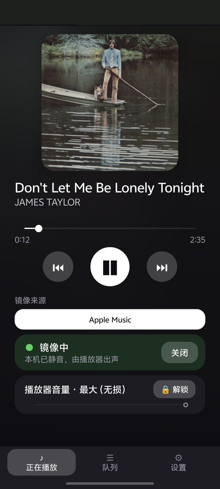
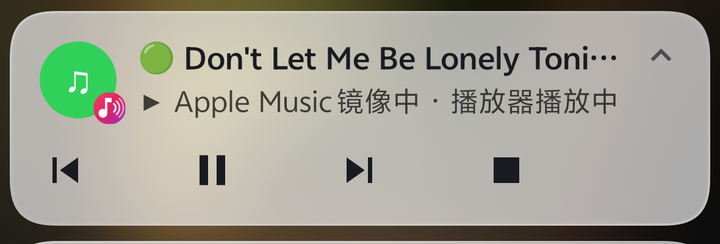
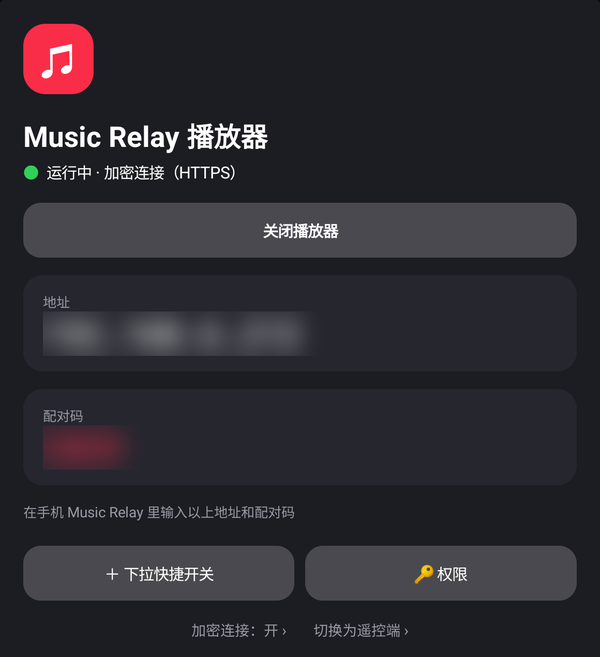
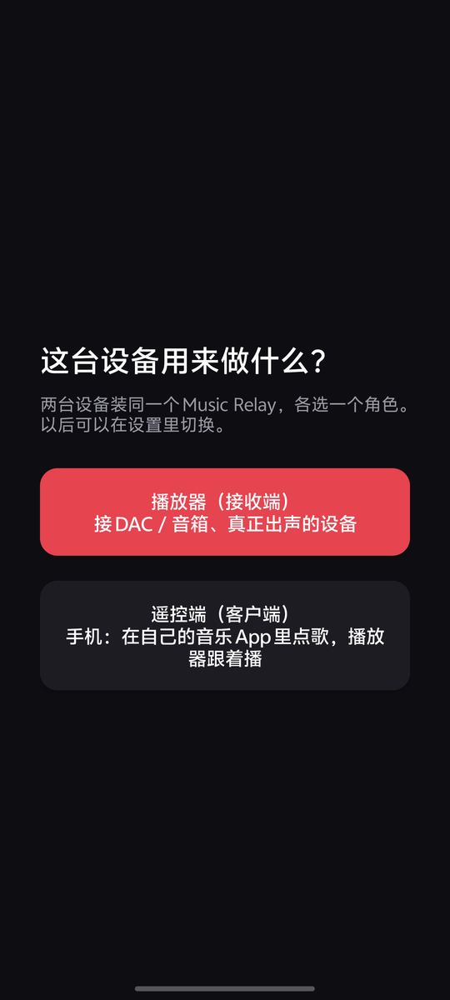
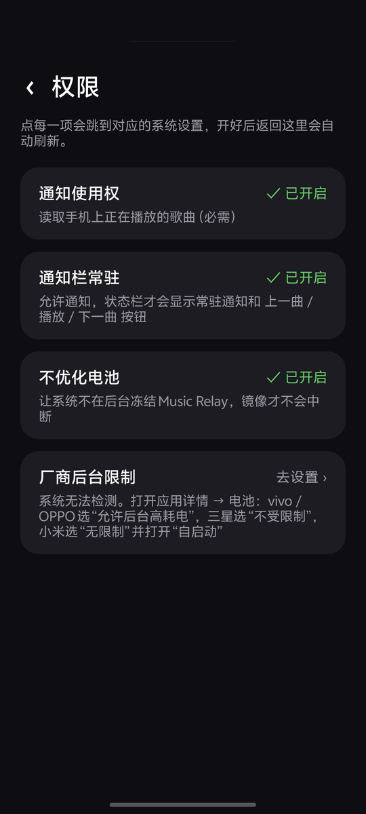
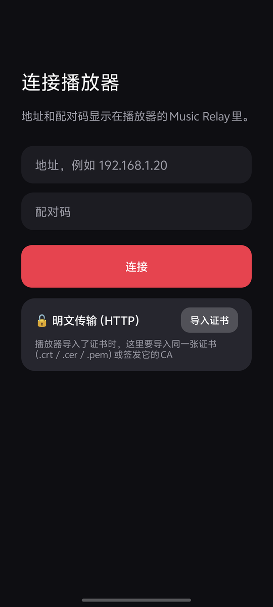
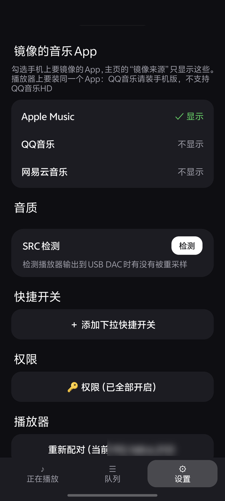
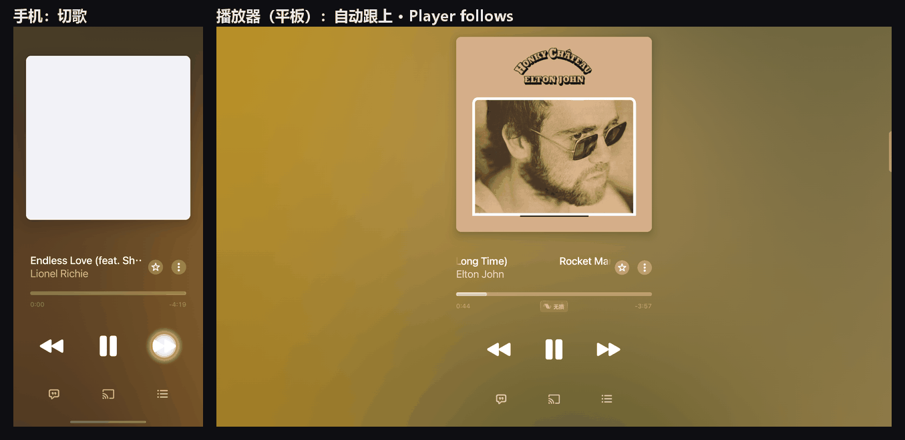

<h1 align="center">Music Relay</h1>

<p align="center">
  在手机上用自己的音乐 App 点歌，让另一台 Android 设备（接 DAC / 音箱的平板、电视盒子）跟着播放。
</p>

<p align="center">
  <a href="README.md">English</a> · <b>简体中文</b>
</p>

<p align="center">
  
  
  
</p>

## 它解决什么问题

Apple Music、QQ音乐、网易云在 Android 上都不支持“手机点歌、另一台设备出声”（没有 AirPlay / Spotify Connect 那样的功能）。
Music Relay 的做法很简单：**两台设备都装官方音乐 App 并登录同一个账号，Music Relay 只负责同步“播什么、播到哪、暂停还是播放”。**

```
手机（遥控端）                                    播放器（接收端）
官方音乐 App  ── 读取正在播放的歌曲 ID ──►  Music Relay  ── 局域网 ──►  Music Relay ──► 官方音乐 App ──► DAC / 音箱
（本机静音）                                                            （按 ID 播放同一首歌）
```

- 不传输音频，不解密、不绕过任何 DRM；音质就是播放器上官方 App 的音质。
- 只用 Android 公开接口：MediaSession（通知使用权）、App 自己的歌曲链接。

## 功能

- **镜像模式**：在手机的音乐 App 里切歌、暂停、拖进度，播放器 1 秒内跟上；手机自动静音。
- **支持的 App**：Apple Music、Apple Music 古典乐、QQ音乐、网易云音乐。古典乐和 Apple Music 是同一个曲库，播放器上用 Apple Music 播放，只需安装 Apple Music；可以在设置里选择显示哪些，也可以“自动”跟随正在播放的那个。
- **通知栏控制**：常驻通知带 ⏮ ⏯ ⏭ 按钮（手机和播放器两边都有），手机通知里还有“停止镜像”。
- **下拉快捷开关**：像 VPN 开关一样一键开关镜像 / 播放器。
- **播放队列**、**播放器音量**（默认锁定在最大，避免数字衰减）。
- **SRC 检测**：看播放器输出到 USB DAC 时有没有被重采样，以及为什么。
- **一个 App 两种角色**：同一个 APK，首次打开选择“播放器”或“遥控端”，之后可以在设置里切换。
- **权限页**：列出所有需要的权限和当前状态，点一下跳到对应的系统设置。
- **可选加密**：播放器上一个开关；手机配对时自动识别，不用设置。

## 准备

| | 要求 |
|---|---|
| 系统 | 两台设备都是 Android 11 及以上，连在同一个局域网 |
| 音乐 App | 两台设备装**同一个**音乐 App，并登录有会员的账号 |
| QQ音乐 | 播放器上要装**手机版 QQ音乐**（`com.tencent.qqmusic`），**不支持 QQ音乐HD**：HD 版的歌曲 ID 是本地编号，无法按歌曲播放。平板上从应用商店搜“QQ音乐”安装手机版即可，横屏问题见下方常见问题 |

## 安装

到 [Releases](../../releases) 下载 `music-relay-<版本>.apk`，在两台设备上都安装。

## 使用步骤

### 1. 播放器：选择角色

在接 DAC / 音箱的设备上打开 Music Relay，选 **播放器（接收端）**。



### 2. 播放器：开权限

点 **🔑 权限**，把标“未开启”的项逐个点开授权。每一项都会跳到对应的系统设置，返回后状态自动刷新。



| 权限 | 用途 |
|---|---|
| 通知使用权 | 读取并控制本机音乐 App（必需） |
| 通知栏常驻 | 显示常驻通知和播放按钮 |
| 不优化电池 | 防止系统在后台冻结 Music Relay |
| 厂商后台限制 | vivo：应用信息 → 电量 → 后台耗电管理 → **允许后台耗电**；三星：电池 → 不受限制；小米：省电策略 → 无限制 + 自启动 |
| 显示在其他应用上层 | QQ音乐、网易云需要在后台打开歌曲链接 |
| 使用情况访问 | 判断前台是不是音乐 App，切歌时不盖住你正在用的界面 |
| SRC 检测（可选） | 需要电脑执行一次 `adb shell pm grant app.musicrelay android.permission.DUMP` |

### 3. 播放器：记下地址和配对码


### 4. 手机：选择遥控端并配对

在手机上打开 Music Relay，选 **遥控端（客户端）**，输入播放器上显示的地址和配对码。然后同样到 **设置 → 🔑 权限** 开好权限。



### 5. 手机：选择要镜像的 App

**设置 → 镜像的音乐 App**：勾选手机上要镜像的 App。主页的“镜像来源”只显示勾选的这些。



### 6. 开启镜像，在手机的音乐 App 里点歌

主页点 **开启**（或下拉快捷开关里的 **Relay 镜像**）。手机静音，之后在手机的 Apple Music / QQ音乐 / 网易云里点歌、暂停、拖进度，播放器都会跟着做。



通知栏里可以直接切歌：


关闭镜像时，播放器上的音乐 App 会暂停，Music Relay 进入待命，手机恢复音量。

## 加密连接（可选）

默认不加密，家里自用一般够了：同一 Wi-Fi 下的人理论上能看到播放指令和配对码，但看不到账号，也没有音频。

想加密，只需两步：

1. 播放器页底部点 **加密连接：关 ›**，选 **开**。证书会自动生成，什么都不用准备。
2. 手机上 **设置 → 重新配对**，输入配对码。手机会自动识别并记住这台播放器，设置里显示“🔒 已加密连接”。

以后手机只认这台播放器。播放器的加密设置改过之后，在手机上重新配对一次就行。

<details>
<summary>高级：使用自己的证书</summary>

已经有自建 CA 的用户，可以在播放器的“加密连接”页里选 **使用自己的证书**，导入带私钥的 `.p12`。手机端不用任何设置，照样重新配对一次即可。

如果手机信任这个 CA，并且证书里写有播放器的 IP，以后续签换证书时手机会自动接受，不用重新配对。

</details>

## 常见问题

**平板有时跟、有时不跟？**
多半是手机系统在后台冻结了 Music Relay。vivo 默认是“智能控制后台耗电”，会间歇冻结镜像，要改成 应用信息 → 电量 → 后台耗电管理 → **允许后台耗电**。其他品牌见上面权限表里的“厂商后台限制”。

**开启镜像后手机还在出声？**
从下拉快捷开关开启时，部分系统（例如 vivo）不允许后台应用修改音量，手机不会被自动静音。在 App 里点“开启”就可以。

**关闭镜像后，播放器的通知栏里还留着 Apple Music？**
Apple Music 暂停后仍保留自己的前台服务，普通应用无法结束它。音乐已经停止、不占音频，需要的话在播放器上手动划掉。

**QQ音乐 / 网易云第一次切歌慢？**
冷启动时 QQ音乐会先显示开屏广告，网易云会先打开首页，Music Relay 会自动重发并按播放，通常几秒内播上。

**平板上的手机版 QQ音乐只能竖屏？**
较新的 Android 仍会尊重 QQ音乐的竖屏锁定。可以用 adb 对它单独放开：
`adb shell am compat enable OVERRIDE_ANY_ORIENTATION com.tencent.qqmusic`，
`adb shell am compat enable OVERRIDE_ANY_ORIENTATION_TO_USER com.tencent.qqmusic`
（恢复：`adb shell am compat reset-all com.tencent.qqmusic`）。

**看视频时手机里的音乐被暂停了，播放器也停了？**
这是镜像的正常行为：手机暂停，播放器跟着暂停。看完视频在手机上继续播放即可。

**能不能在 Music Relay 里搜歌？**
不能，也不打算做：直接在手机自己的音乐 App 里搜、点，播放器跟着播。

## 从源码构建

不需要 Gradle，只需要 Android SDK（build-tools 34.0.0、platforms;android-34）和 JDK 17：

```bash
export ANDROID_HOME=/path/to/android-sdk
./build.sh            # 生成 build/music-relay.apk，使用本地 debug 签名
```

正式签名：设置 `KEYSTORE`、`KEYSTORE_PASS`、`KEY_ALIAS` 再运行。Windows 下在 Git Bash 里运行即可。

局域网接口说明见 [docs/protocol.md](docs/protocol.md)。

## 声明

- 本项目与 Apple、腾讯、网易无关。Apple Music、QQ音乐、网易云音乐是各自所有者的商标。
- Music Relay 只发送播放控制指令，需要你在两台设备上都有合法的账号和会员。

## 许可证

[MIT](LICENSE)
